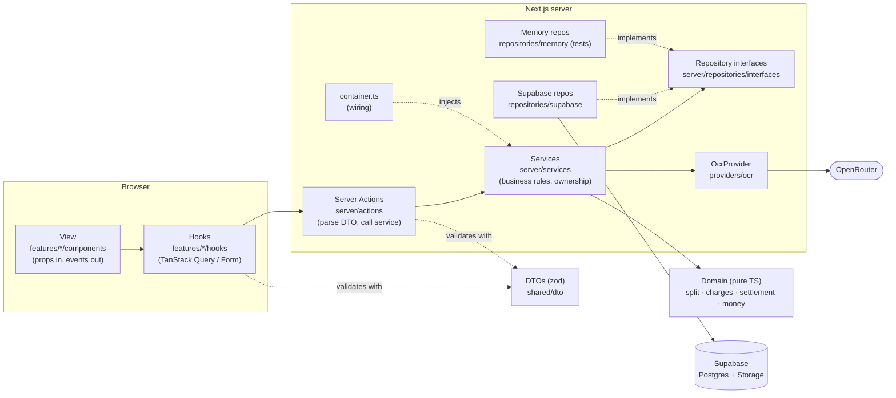
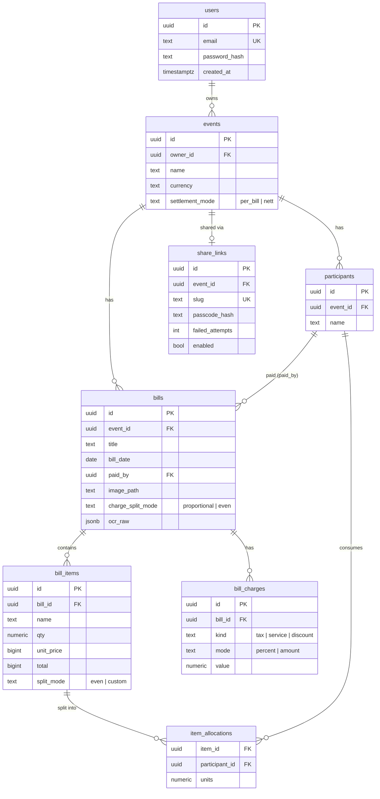
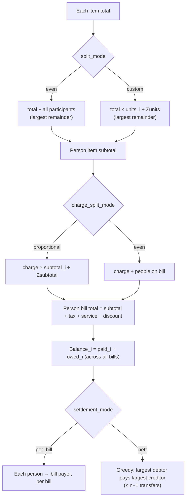
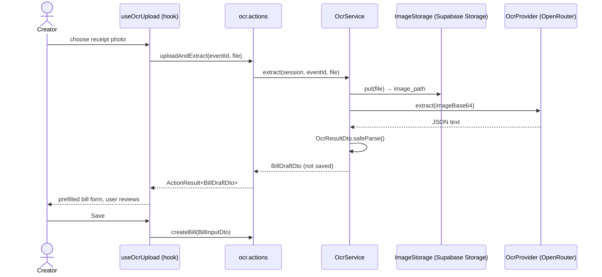
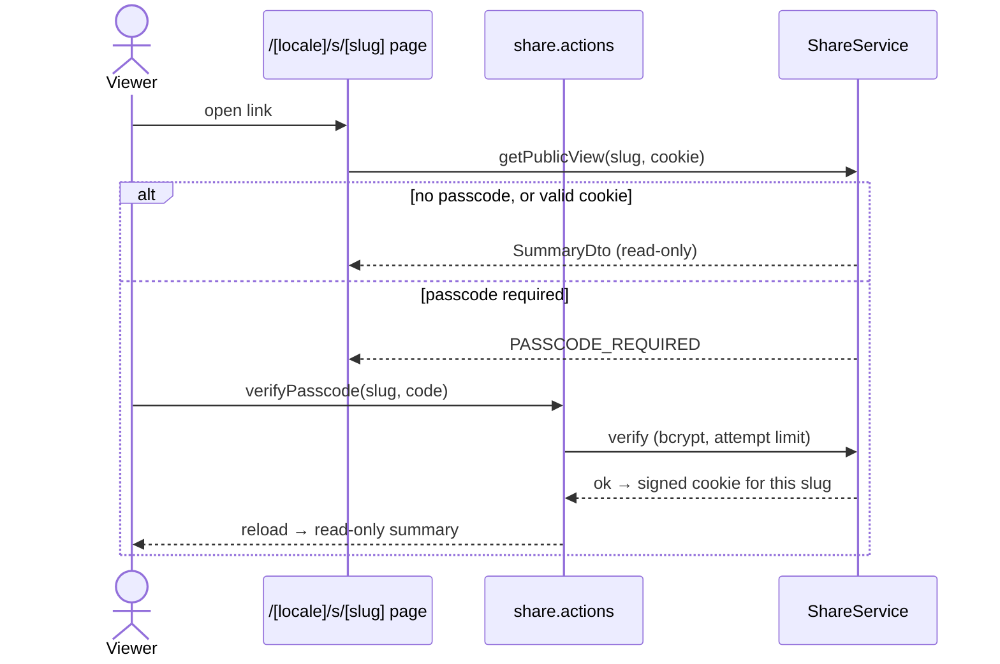

# Architecture

These diagrams use **Mermaid**. They render on GitHub and in VS Code: install the extension *"Markdown Preview Mermaid Support"*, then press `Ctrl+Shift+V`.

## 1. Layers

**Rule:** arrows only point inward. Only the files in `repositories/supabase/` know Supabase exists. To replace the database, write `repositories/<new-db>/` and change `container.ts`.

## 2. Data model (ERD)

## 3. How a bill is calculated

## 4. OCR flow

## 5. Share link flow

